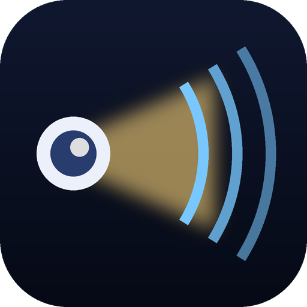
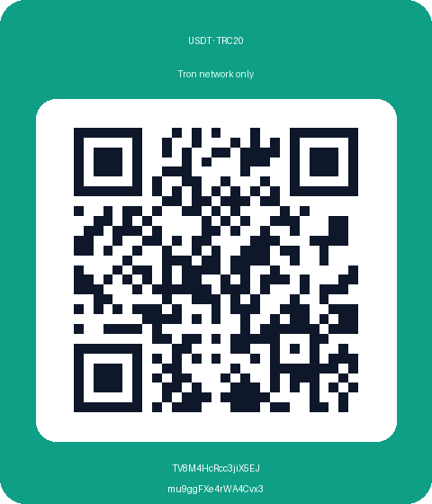

<div align="center">



# BeamPlay

**AirPlay for your projector or Android TV — no Apple TV needed.**

Mirror an iPhone, iPad or Mac, play music from Apple Music, and send videos straight to the big screen.
A free, open-source AirPlay receiver for Android TV / Google TV, built and used every day on a BenQ GP520 projector.


<a href="https://send.monobank.ua/jar/6YqKSm3yaD"></a>

</div>

---

## Why

Many projectors and TVs run Android TV and can't receive AirPlay, or ship a vendor AirPlay app that drops
connections, can't play video links and shows ads. BeamPlay turns the device into a proper AirPlay target that
your Apple devices see like an Apple TV — in Control Center, in the Music app and in the video player.

## Highlights

- 📱 **Screen mirroring** from iPhone, iPad and Mac, with sound — advertised at 1440p, the sender adapts the bitrate.
- 🎵 **AirPlay audio**: Apple Music, podcasts and any app's sound, with a tvOS-style **Now Playing** screen
  (artwork, title, progress).
- 🎬 **Video links**: when a site or app hands over a plain video URL (HLS / MP4), BeamPlay plays it itself in
  full quality, with pause, seek and episode switching — the phone is free while it plays.
- 💡 **Wakes the projector**: an incoming AirPlay session turns the display on from standby.
- 🔊 **Fixed volume**, like Roku and Apple TV on receivers: volume stays on your sound system, the phone slider
  doesn't fight it.
- 🔐 Optional **PIN pairing** so neighbours can't take over the screen.
- 🖥️ tvOS-style interface for the remote: idle screen, connection status, two-pane settings.
- 🚀 Starts on boot and keeps running in the background.
- 🆓 No ads, no account, no cloud — everything stays in your home network.

## What doesn't work

- **DRM-protected video** (Netflix, Apple TV+, Disney+ and sites whose player uses FairPlay streaming).
  Those senders require Apple-licensed keys that no open-source receiver has. Use the TV's own apps.
- **Multi-room** (playing in sync with HomePods) — not supported.
- Some sites' web players in Safari hand over an encrypted stream instead of a URL; those can only be mirrored.

## Installation

1. Download the latest `BeamPlay-*.apk` from [Releases](https://github.com/zegioni/beamplay/releases).
2. Install it on the TV/projector, for example over the network with ADB:
   ```bash
   adb connect <tv-ip>:5555
   adb install -r BeamPlay-googletv-1.0.0.apk
   ```
   or copy the APK to a USB stick and open it with a file manager.
3. Open **BeamPlay** once. It starts its service, and from now on it also starts with the device.
4. On your iPhone/Mac: Control Center → Screen Mirroring (or the AirPlay icon in any player) → pick your TV.

The `googletv` build is for Android TV / Google TV (Android 10+), the `firetv` build for Fire TV (Fire OS 6+).

## Build from source

Requirements: JDK 17, Android SDK (platform 35, NDK + CMake for the native decoders).

```bash
git clone https://github.com/zegioni/beamplay.git
cd beamplay
echo "sdk.dir=$ANDROID_HOME" > local.properties
./gradlew assembleGoogletvDebug          # or assembleGoogletvRelease / assembleFiretvDebug
./gradlew testGoogletvDebugUnitTest      # unit tests
```

The APK lands in `app/build/outputs/apk/<flavor>/<buildType>/`.
More in [docs/ARCHITECTURE.md](docs/ARCHITECTURE.md) and [docs/guides/](docs/guides/).

## Good to know

- The TV and the Apple devices must be in the same network (same Wi-Fi / LAN, mDNS not blocked by the router).
- If the TV doesn't show up, open BeamPlay once and check that it's allowed to run in the background
  (some vendors' "memory cleaners" kill background apps).
- For the best mirroring quality use 5 GHz Wi-Fi or Ethernet on the TV.

## Support the project

If BeamPlay saves you an Apple TV (or just time), you can drop something into the jar:

<table>
<tr>
<td align="center" width="50%">
<a href="https://send.monobank.ua/jar/6YqKSm3yaD"></a>

**🫙 monobank jar «отложить гривны»**

<a href="https://send.monobank.ua/jar/6YqKSm3yaD"></a>

🔗 https://send.monobank.ua/jar/6YqKSm3yaD

💳 `4874 1000 3321 2872`
</td>
<td align="center" width="50%">


**💵 USDT · Tron (TRC20)**

`TV8M4HcRcc3jiX5EJmu9ggFXe4rWA4Cvx3`

<sub>Send only USDT on the Tron network (TRC20); other coins or networks will be lost.</sub>
</td>
</tr>
</table>

Thank you! 💛💙

## Credits

BeamPlay started from **[PhairPlay](https://github.com/mazer666/PhairPlay)** by mazer666 and contributors
(Apache License 2.0). Thank you! BeamPlay has since been reworked, renamed and is maintained separately; it is not
affiliated with the PhairPlay authors. It also builds on the Apple ALAC decoder, playfair and the Inter typeface —
see [NOTICE.md](NOTICE.md).

AirPlay, Apple TV, HomePod, iPhone, iPad and Mac are trademarks of Apple Inc. BeamPlay is not affiliated with
or endorsed by Apple.

## License

BeamPlay is free software under the **GNU AGPL v3** with additional terms (attribution, name and icon) —
see [LICENSE](LICENSE) and [NOTICE.md](NOTICE.md). The original PhairPlay code is also available under the
Apache License 2.0: [LICENSES/Apache-2.0-PhairPlay.txt](LICENSES/Apache-2.0-PhairPlay.txt).

> [!WARNING]
> **Use at your own risk.** BeamPlay is provided as is, without any warranty.
